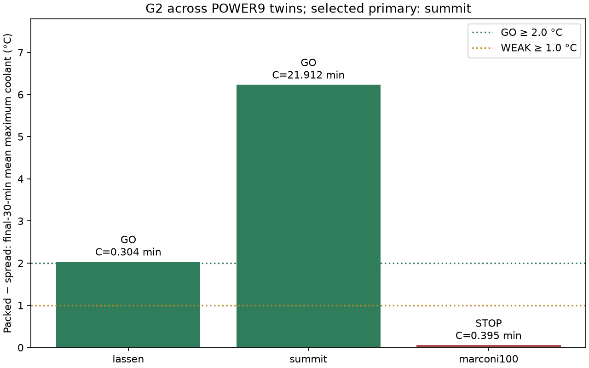

# X01 — Mechanical primary-FMU selection
**System:** cross_system  **Status:** complete
**Pre-registered:** 2026-10-27; commit `c6e127a9e453fe7eaba55cd9f011d9cdbeb88e01` (before execution).

## Question
Which FMU should be primary according to the frozen G2 effect-size, sanity and cost rule?

## Pre-registered decision rule
**Common methodology.** The same protocol runs on each of Lassen, Summit and Marconi100, each in its own process:

1. Instantiate `FmuBackend` with that system's coupling.
2. Warm up: 7200 s at the idle vector, with `dt = Δ_system`.
3. Run two branches from the snapshot. Each branch: `reset()`, then 3 h at `dt = Δ_system`.
   - **spread:** all racks at `P(0.6) = idle + 0.6·(peak − idle)`.
   - **packed:** the same total (`n × P(0.6)`). Racks 0..k−1 run at `peak`, rack k at the remainder, the rest at `idle`.
4. Ambient: 290 K for all inputs.

**Recorded per system:**

| Name | Definition |
|---|---|
| `Δ_s` | (packed max-rack °C) − (spread max-rack °C), mean over the final 30 min |
| `class_s` | GO if Δ ≥ 2.0 °C; WEAK if 1.0 ≤ Δ < 2.0; STOP if Δ < 1.0 |
| `fmu_s_per_sim_h` | Measured FMU-only wall time per simulated hour |
| `C_s` | Projected closed-loop minutes per 6 h run: `fmu_s_per_sim_h × 6 × 1.5 / 60` (1.5 is the RAPS overhead factor, an ASSUMPTION) |
| `sane_s` | Warm-up completed; all outputs finite; all coolant temperatures in [10, 70] °C; no FMU exception |

**Selection rule (applied mechanically, recorded in `experiments/cross_system/X01_fmu_selection/`):**
1. **Eligible** = `sane_s` AND `C_s ≤ 30` min.
2. Among eligible systems, the **candidate** is the one with the largest `Δ_s`.
3. **Tie-break:** if another eligible system has `Δ ≥ 0.8 × Δ_candidate` and the same class, choose the one with the lower `C_s`.
4. If the chosen class is **STOP**, stop and report. The demo story needs replanning.
5. If the chosen class is **WEAK**, proceed and record that the hotspot story is reframed as "modest".
6. **Post-selection guard:**
   - If the Task 5 bench (RAPS + FMU, idle) measures more than 45 min per 6 h run for the primary, switch to the next eligible system in selection order.
   - Re-run G1 and G3 on that system.
   - Record the switch.


### Approved reproducibility clarification
Approved by Bipin in conversation on 2026-10-27: compare canonical deterministic scientific-summary bytes and thermal-series content across the Lassen rerun, excluding exactly `fmu_s_per_sim_h` and `projected_closed_loop_min_6h` from the scientific summary. Preserve each full summary and timing measurement separately. X01 uses only the original runs' costs. Do not claim full-summary byte identity. No physical threshold, input, horizon or selection rule changes. Rerun artifacts: `provenance/rerun_1_data/`; comparison: `provenance/rerun_1.json`.

## Configuration
[config.yaml](config.yaml), JSON/YAML. Use only the original E02 summaries; no system preferred in advance.

## Method
After the three G2 processes and the retained Lassen reproducibility check, run from `thermoRL/thermorl-v2`:

```bash
uv run python -m thermorl2.experiments.select_fmu --out experiments/cross_system/X01_fmu_selection experiments/lassen/E02_g2_packed_vs_spread/results/summary.json experiments/summit/E02_g2_packed_vs_spread/results/summary.json experiments/marconi100/E02_g2_packed_vs_spread/results/summary.json
```

Expected wall time: seconds. Among eligible systems, rank by descending Δ; among systems of the candidate's class with at least 80% of its Δ choose lowest cost. Exact numeric ties use system name for deterministic ordering only. Rank remaining eligible systems by repeating the same rule on the remainder, to identify the runner-up for the future cost guard. No eligible system yields no primary and a stop report.

## Metrics
Original-run Δ, class, C_s, sanity, eligibility, primary, runner-up and tie-break. No aggregate effect claim across unlike twins.
## Results
| System | Δ °C | Class | C_s min / 6 h | Sane | Eligible |
|---|---:|---|---:|---|---|
| lassen | 2.036319592756 | GO | 0.304157671949 | True | True |
| summit | 6.234888984342 | GO | 21.912337247551 | True | True |
| marconi100 | 0.054796806701 | STOP | 0.394916788800 | True | True |

Primary: **summit**; runner-up: **lassen**; tie-break applied: **False**. [Machine-readable decision](results/summary.json); [CSV](results/g2_comparison.csv).

## Plots


## Observations (FACT)
All three completed warm-up and passed sampled-output sanity, and all three original C_s values are <=30 min. Summit has the largest Δ. The 80% tie threshold is 4.987911187473 °C; Lassen (2.036319592756 °C) is below it. The selection pool therefore contains Summit alone. The Lassen independent rerun has byte-identical scientific and thermal results, with separate timings retained.

## Interpretation (INFERENCE)
The frozen rule selects the stronger hotspot contrast despite its substantially higher runtime. This establishes the demo operating twin, not scheduler superiority. Its 21.91 min projection is an overhead assumption; Task 5 still measures the actual engine cost.

## Conclusion and decision
**GO; primary Summit, runner-up Lassen, no tie-break.** Continue to G1/G3 on Summit. No STOP condition is triggered by Marconi100's individual STOP classification because the chosen system is GO.

## Limitations
Projected RAPS overhead is an assumption; Task 5 retains its post-selection guard. Rerun costs do not replace original selection costs.
## Provenance
[Manifest](provenance/manifest.json) records source-summary hashes, git state, config, backend=fmu and timing. Selection consumed original G2 summaries only, with their hashes embedded in [summary.json](results/summary.json).

## Demo relevance
Freezes the primary before calibration and closed-loop implementation.
