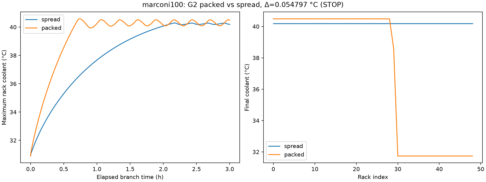

# E02 — G2 packed versus spread (marconi100)
**System:** marconi100  **Status:** complete
**Pre-registered:** 2026-10-27; commit `c6e127a9e453fe7eaba55cd9f011d9cdbeb88e01` (before execution).

## Question
At identical total rack power, how large is the packed-minus-spread hotspot effect, and is this FMU eligible for primary selection?

## Pre-registered decision rule
**Common methodology.** The same protocol runs on each of Lassen, Summit and Marconi100, each in its own process:

1. Instantiate `FmuBackend` with that system's coupling.
2. Warm up: 7200 s at the idle vector, with `dt = Δ_system`.
3. Run two branches from the snapshot. Each branch: `reset()`, then 3 h at `dt = Δ_system`.
   - **spread:** all racks at `P(0.6) = idle + 0.6·(peak − idle)`.
   - **packed:** the same total (`n × P(0.6)`). Racks 0..k−1 run at `peak`, rack k at the remainder, the rest at `idle`.
4. Ambient: 290 K for all inputs.

**Recorded per system:**

| Name | Definition |
|---|---|
| `Δ_s` | (packed max-rack °C) − (spread max-rack °C), mean over the final 30 min |
| `class_s` | GO if Δ ≥ 2.0 °C; WEAK if 1.0 ≤ Δ < 2.0; STOP if Δ < 1.0 |
| `fmu_s_per_sim_h` | Measured FMU-only wall time per simulated hour |
| `C_s` | Projected closed-loop minutes per 6 h run: `fmu_s_per_sim_h × 6 × 1.5 / 60` (1.5 is the RAPS overhead factor, an ASSUMPTION) |
| `sane_s` | Warm-up completed; all outputs finite; all coolant temperatures in [10, 70] °C; no FMU exception |

**Selection rule (applied mechanically, recorded in `experiments/cross_system/X01_fmu_selection/`):**
1. **Eligible** = `sane_s` AND `C_s ≤ 30` min.
2. Among eligible systems, the **candidate** is the one with the largest `Δ_s`.
3. **Tie-break:** if another eligible system has `Δ ≥ 0.8 × Δ_candidate` and the same class, choose the one with the lower `C_s`.
4. If the chosen class is **STOP**, stop and report. The demo story needs replanning.
5. If the chosen class is **WEAK**, proceed and record that the hotspot story is reframed as "modest".
6. **Post-selection guard:**
   - If the Task 5 bench (RAPS + FMU, idle) measures more than 45 min per 6 h run for the primary, switch to the next eligible system in selection order.
   - Re-run G1 and G3 on that system.
   - Record the switch.


### Approved reproducibility clarification
Approved by Bipin in conversation on 2026-10-27: compare canonical deterministic scientific-summary bytes and thermal-series content across the Lassen rerun, excluding exactly `fmu_s_per_sim_h` and `projected_closed_loop_min_6h` from the scientific summary. Preserve each full summary and timing measurement separately. X01 uses only the original runs' costs. Do not claim full-summary byte identity. No physical threshold, input, horizon or selection rule changes. Rerun artifacts: `provenance/rerun_1_data/`; comparison: `provenance/rerun_1.json`.

## Configuration
[config.yaml](config.yaml), encoded as JSON (a YAML subset). 49 racks, 20 s ticks, 7200 s capped idle preconditioning, 10800 s per branch, load fraction 0.6, air/external 290 K. Idle/peak are measured RAPS model values. A negative settlement threshold enforces the prescribed fixed warm-up without altering backend semantics.

## Method
From `thermoRL/thermorl-v2`, after committing this preregistration:

```bash
uv run python -m thermorl2.experiments.probes g2 --system marconi100 --out experiments/marconi100/E02_g2_packed_vs_spread
```

Launch all three systems as separate parallel OS processes. Verify SHA before instantiation. One backend; restore the same snapshot before spread and packed. Check all sampled rack/CDU/global outputs for finiteness and sampled coolant in [10,70] °C, including warm-up. Preserve branch t=0 and every subsequent tick. Expected wall time: minutes for Lassen/Marconi100, 30–60 minutes for Summit. Rerun Lassen independently into its retained provenance subtree using the identical frozen config.

## Metrics
At each right endpoint, compute max rack coolant, mean rack coolant, and max-minus-min spread. Average each over the final 1800 s (`9000 < t_s <= 10800`). Δ is packed mean maximum minus spread mean maximum, °C. FMU-only cost includes initialization, warm-up, branch resets, observation calls, steps and close, divided by the total 8 simulated hours. Python aggregation and plotting are excluded from FMU runtime and recorded separately in wall timings. C_s uses the frozen 1.5 overhead assumption.

## Results
| Quantity | Value |
|---|---:|
| Total rack power, both branches (kW) | 1375.880800000000 |
| Spread max / mean / spread (°C) | 40.228450245424 / 40.228450147531 / 1.96002284585e-07 |
| Packed max / mean / spread (°C) | 40.283247052125 / 36.926063162676 / 8.563890840124 |
| Δ (°C), class | 0.054796806701, **STOP** |
| FMU-only s / simulated h | 2.632778592002 |
| Projected C_s (min / 6 h) | 0.394916788800 |
| Original run wall time (s) | 22.922057085 |
| Sanity | True |

[Full summary](results/summary.json); [scientific summary](results/scientific_summary.json); [complete rack ledger](results/series.parquet); [warm-up](results/warmup.parquet); [CDU-1/global ledger](results/globals.parquet).

## Plots


## Observations (FACT)
The fixed warm-up used exactly 7200 s. The [independent ledger audit](provenance/independent_ledger_audit.json) reconciles equal total power, time grids and summary metrics. Initial branch observations match exactly for rack coolant, all recorded extras and globals. All sampled outputs were finite; sampled coolant range was 30.000000000000–40.581387524435 °C. There were 29 fully loaded racks in the packed vector.

## Interpretation (INFERENCE)
The large rack-temperature spread within the packed branch does not imply a large maximum-temperature advantage over spread. Both branch maxima are near 40 °C; their difference is below the frozen STOP threshold under this protocol.

## Conclusion and decision
Per-system G2 classification: **STOP**. Sanity passed and the original measured C_s is below 30 min, so the system is eligible for X01. Only the X01-selected system's STOP classification would stop the demo sequence.

## Limitations
One homogeneous twin; capped initialization; restore jitter. G2 measures placement contrast, not advantage beyond power balancing. Wall cost is machine-specific; 1.5 overhead is an assumption.
## Provenance
[Manifest](provenance/manifest.json), [environment](provenance/environment.txt), [exact inputs](provenance/input_sequence.json), [branch initial observations](provenance/branch_initial_observations.json). Git `41c658563eb4a51b7a30f0d2b1650e95130e66f2`, dirty=false; source file hashes are recorded. Concurrent experiment outputs made the checkout dirty; implementation was committed before execution. FMU `9dac7818338d0be7fcb887ee88acab01a62eeb7aff4bd286e65874e0ef5c3f77`; workload-vector SHA-256 `f376296e867fe3a2d1c301431efb4ddf8f1cc683d1ffeceb754df6b7dcff9998`. Backend=fmu; policy/seed not applicable. Original run timings are immutable; no result is replaced by a faster rerun.

## Demo relevance
Earliest falsification gate for the hotspot demonstration; feeds mechanical primary selection.
