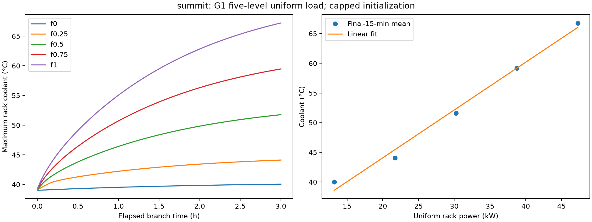

# E01 — G1 five-level uniform-load physics (summit)
**System:** summit  **Status:** complete
**Pre-registered:** 2026-10-27; commit `6f88579f62cc5a0ce235234ba0a66ef15dd5dbec` (before execution).

## Question
What are the finite-horizon temperature–power relation, empirical response times, operating range and rack homogeneity on the selected primary?

## Pre-registered decision rule
The following is copied verbatim from design spec §4.2:

| Exp | Question | Protocol | Primary metric | Decision rule |
|---|---|---|---|---|
| **G1** Uniform sweep | T_ss(P), τ, operating range, rack homogeneity | From the snapshot (reset per level), all racks at `idle + f·(peak−idle)` for f ∈ {0, .25, .5, .75, 1}, 3 h each | Per-level mean/min/max rack °C over the final 15 min; 63 % time; linear fit a, b, R² | Freeze `a`, `b`, `τ` (median t63 over f ∈ {.25, .5, .75}). `t_hot_c` = fit at f = 0.9. Report whether 40 °C or 45 °C is reached. |

## Configuration
[config.yaml](config.yaml), JSON/YAML. Primary is selected mechanically by [X01](../../cross_system/X01_fmu_selection/README.md), not assumed. Power bounds and geometry come from RAPS configuration; FMU hash must match spec §3.1.

## Method
Run all racks at each f in {0,.25,.5,.75,1}, restoring the same capped snapshot before every level. Preserve full warm-up, per-rack coolant/pump/power and CDU-1/global ledgers, plus initial observations. Warm-up: exactly 7200 s at measured idle. Each level: 10800 s, dt=10 s, all ambient inputs 290 K. Check finite outputs and sampled coolant range. A negative settlement threshold enforces the prescribed cap. No time-constant acceptance bound is imposed.

From `thermoRL/thermorl-v2`, after committing this preregistration:

```bash
uv run python -m thermorl2.experiments.probes g1 --system summit --out experiments/summit/E01_g1_uniform
```

G1 and G3 run as separate parallel processes, one FMU per process. Based on the G2 cost, approximate FMU wall costs are 41 minutes for G1 (17 simulated h including warm-up) and 19.5 minutes for G3 (8 simulated h); timing can vary by input and concurrent load. No outcome-dependent horizon adjustment.

## Metrics
Final 15 minutes: `9900 < t_s <= 10800`, right-endpoint samples. Compute each rack's time mean, then mean/min/max across racks. t63 is the first mean-rack sample reaching 0.632 of the signed change from the snapshot to the final-window mean. For f=0 a negative change is reported as cooling/relaxation, not a heating time constant; zero change or no crossing is null. Fit all five points by ordinary least squares; report a, b, R², median t63 over .25/.5/.75, and fit at f=.9. Reach flags refer to any sampled coolant value across the branches. No level is dropped. A final-window average is an operating proxy, not certification of equilibrium.

## Results
| f | Rack kW | Initial mean °C | Final mean °C | Min / max rack mean °C | Signed final change °C | t63 s | Fit residual °C |
|---|---:|---:|---:|---|---:|---:|---:|
| 0 | 13.201714285714 | 39.028228454 | 40.041535223 | 40.041535216 / 40.041535231 | 1.013306770 | 4930 | 1.435533988 |
| 0.25 | 21.721867346939 | 39.028228454 | 44.058848114 | 44.058848112 / 44.058848115 | 5.030619660 | 3550 | -1.407964476 |
| 0.5 | 30.242020408163 | 39.028228454 | 51.579892033 | 51.579892032 / 51.579892034 | 12.551663579 | 4050 | -0.747731911 |
| 0.75 | 38.762173469388 | 39.028228454 | 59.165656596 | 59.165656596 / 59.165656596 | 20.137428142 | 4130 | -0.022778702 |
| 1 | 47.282326530612 | 39.028228454 | 66.792187753 | 66.792187753 / 66.792187754 | 27.763959299 | 4170 | 0.742941101 |

Fit a=27.975385727123 °C; b=0.805245082436 °C/kW; R²=0.989167647689. Frozen empirical tau_s=4050 s, the median of 3550/4050/4130 s. t_hot_c=63.304922110353 °C. Reaches 40 °C: True; reaches 45 °C: True. Full-load final-window rack-mean spread=8.98012331163e-10 °C. Maximum sampled coolant=67.212887472128 °C; sane=True. FMU runtime=1784.156832484 s; total wall=1792.660297044 s.

[Summary](results/summary.json), [complete rack ledger](results/series.parquet), [warm-up](results/warmup.parquet), [CDU-1/global ledger](results/globals.parquet), [independent audit](provenance/independent_ledger_audit.json).

## Plots


## Observations (FACT)
Warm-up used exactly 7200 s. All five branch roots matched for coolant, extras and globals. Final-window means increase monotonically across the five fixed power levels, and racks are nearly identical under uniform power. The idle branch still rises by 1.013306769687 °C from the capped snapshot to its final-window mean, so the snapshot is not thermally stationary. Higher-load traces are still evolving at the 3 h endpoint. G1 warm-up is byte-identical to the independently executed G2 and G3 warm-ups. Independent pandas/lstsq calculations reproduce every level, first crossing, fit and reach flag. The f=1 value follows the frozen idle+f*(peak-idle) floating-point formula: 47.28232653061225 kW, 7.1e-15 kW above the helper's stored peak; exact inputs are preserved, not silently rewritten.

## Interpretation (INFERENCE)
A single linear fit is a useful prescribed operating summary but has nonzero residuals (shown above), and the high-load final-window values are not settled equilibria. The empirical 4050 s parameter describes the first-crossing convention for these fixed branches; it is not evidence for a universal first-order thermal time constant. The measured range reaches both fixed comparison temperatures. None of this establishes benefit over power balancing.

## Conclusion and decision
Freeze all five fitted points, a/b/R², empirical tau_s=4050 and t_hot_c=63.304922110353 as specified, without dropping levels or retuning. primary.yaml references this summary and H=600 s. Stop at C1 for review before engine or policy implementation. The old 500–1000 s physical-response test remains a separate strict XFAIL with unchanged body.

## Limitations
The fitted T_ss notation denotes a final-window proxy over a fixed horizon. Capped warm-up and transients can affect the fitted parameters. Empirical t63 is protocol-specific and is not proof of a first-order plant with a constant time constant.
## Provenance
[Manifest](provenance/manifest.json), [environment](provenance/environment.txt), [exact inputs](provenance/input_sequence.json), [initial observations](provenance/branch_initial_observations.json). Execution git `6f88579f62cc5a0ce235234ba0a66ef15dd5dbec`, dirty=true from concurrent outputs; committed implementation-file hashes verified. FMU `0a6ca3777ed38b75a94ea8d293a68748077db5963fa4b897fdea515615d19233`; input-vector SHA `70a10b1844a184e5cbef73877bd0cdd082c607de16326f4c119f27a5518fd333`; config SHA `9636a56c91fafdd18fcd91650f404caddc4a1c0958521b5c41ade06f6eea71b7`. Backend=fmu; no policy, seed or RAPS engine runtime. Timings are those actually measured, not the preregistration estimate.

## Demo relevance
Freeze the model parameters and operating range before policy comparisons.
