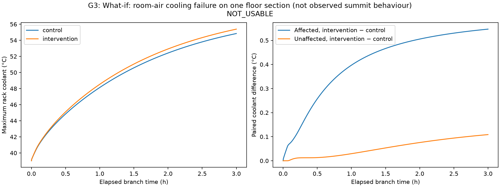

# E03 — G3 — What-if: room-air cooling failure on one floor section (not observed summit behaviour)
**System:** summit  **Status:** complete
**Pre-registered:** 2026-10-27; commit `6f88579f62cc5a0ce235234ba0a66ef15dd5dbec` (before execution).

## Question
Does raising room-air temperature on the frozen last-quarter rack set produce the preregistered coolant change at fixed power?

## Pre-registered decision rule
The following is copied verbatim from design spec §4.2:

| Exp | Question | Protocol | Primary metric | Decision rule |
|---|---|---|---|---|
| **G3** Lever | Does room air change coolant temperature at fixed power? | All racks at f = 0.6. Control: 290 K. Intervention: what-if racks at 308.15 K. 3 h. | Δ coolant °C on affected racks (mean, final 30 min); Δ on unaffected racks | **USABLE** if ≥ 1.0 °C AND outputs are sane (finite, ≤ 70 °C). Otherwise NOT_USABLE, and the what-if is dropped. |

## Configuration
[config.yaml](config.yaml), JSON/YAML. Primary is selected mechanically by [X01](../../cross_system/X01_fmu_selection/README.md), not assumed. Power bounds and geometry come from RAPS configuration; FMU hash must match spec §3.1.

## Method
One FMU process; exactly 7200 s capped idle preconditioning, dt=10 s, snapshot restore before each branch. Both branches use all racks at idle + .6*(peak-idle), 10800 s. Control air/external 290 K; intervention raises air to 308.15 K on zero-based racks 192–256 only; external and all other rack air inputs remain 290 K. Preserve complete paired ledgers and verify identical branch-time observations. A negative settlement threshold enforces the fixed warm-up. The parameter list is descriptive only.

From `thermoRL/thermorl-v2`, after committing this preregistration:

```bash
uv run python -m thermorl2.experiments.probes g3 --system summit --out experiments/summit/E03_g3_room_air
```

G1 and G3 run as separate parallel processes, one FMU per process. Based on the G2 cost, approximate FMU wall costs are 41 minutes for G1 (17 simulated h including warm-up) and 19.5 minutes for G3 (8 simulated h); timing can vary by input and concurrent load. No outcome-dependent horizon adjustment.

## Metrics
Paired intervention minus control, averaged across affected racks and the final 1800 s (`9000 < t_s <= 10800`); report unaffected-rack mean difference too. USABLE iff the affected mean difference is >=1.0 °C and outputs are sane (finite, coolant <=70 °C). No alternative lever is tested if NOT_USABLE. List the modelDescription.xml variables satisfying the exact parameter/tunable/CDU-1 name filters, without setting any of them.

## Results
| Quantity | Value |
|---|---:|
| Affected racks (zero-based) | 192–256 (65 racks) |
| Intervention room-air input | 308.15 K |
| Final-30-min affected paired coolant difference | 0.538986028132 °C |
| Final-30-min unaffected paired difference | 0.101837403880 °C |
| Sane | True |
| Decision | **NOT_USABLE** |
| Maximum sampled coolant | 55.388075255282 °C |
| FMU wall / total wall | 1193.584842169 / 1201.512794927 s |
| Candidate CDU parameters listed, none applied | 62 |

[Summary](results/summary.json), [complete rack ledger](results/series.parquet), [CDU-1/global ledger](results/globals.parquet), [warm-up ledger](results/warmup.parquet), [candidate CDU parameter list](results/candidate_cdu_parameters.txt).

## Plots


## Observations (FACT)
The 7200 s cap was used exactly. Both branch roots matched exactly for coolant, extras and globals. All sampled outputs were finite, with coolant <=70 °C. The [independent audit](provenance/independent_ledger_audit.json) reproduced both paired metrics and the rule outcome. Control equals the original G2 spread trajectory exactly, and its warm-up ledger is byte-identical to G2. Branch total powers are identical. The parameter list exactly matches the modelDescription.xml filters; no candidate parameter was set.

## Interpretation (INFERENCE)
The raised room-air input has a measurable effect under this finite-horizon protocol, but its affected mean difference falls below the frozen usability threshold. This result supports dropping the specified what-if from the demo. It does not justify lowering the threshold, extending the horizon, tuning a CDU parameter, or claiming an observed Summit failure.

## Conclusion and decision
**NOT_USABLE** (0.538986028132 °C < 1.0 °C). Drop the room-air what-if under this plan. Candidate parameters are a list only; no alternative lever or substitute experiment is introduced. Nominal closed-loop work remains the proposed next phase after C1 review.

## Limitations
What-if: room-air cooling failure on one floor section (not observed summit behaviour). Room air is a model input, not evidence that this event occurred on Summit. A negative result drops the what-if; no post-result parameter tuning or substitute experiment.
## Provenance
[Manifest](provenance/manifest.json), [environment](provenance/environment.txt), [inputs](provenance/input_sequence.json), [branch roots](provenance/branch_initial_observations.json). Execution git `6f88579f62cc5a0ce235234ba0a66ef15dd5dbec`, dirty=false from concurrent experiment outputs; implementation source hashes recorded. FMU `0a6ca3777ed38b75a94ea8d293a68748077db5963fa4b897fdea515615d19233`; workload-vector SHA `8fbd8a246cfd957940bfc6d17f18791c5765516e7f7eadc5f803f244345d6bb1`. Config SHA `f491dd5ceb94fe283fe02693fa1596e39ae75b600212f7589ba46fbc7fb8626b`. Backend=fmu; no policy, seed or RAPS execution.

## Demo relevance
Determine whether the frozen room-air what-if is available; no substitute lever is introduced.
