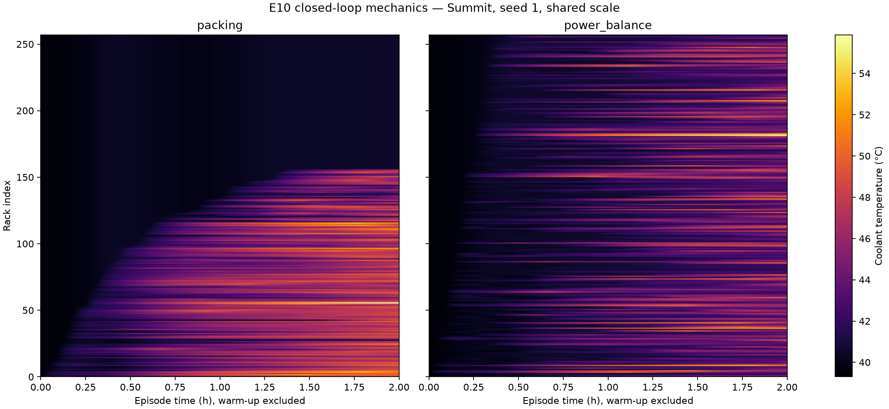

# E10 — First closed-loop vertical-slice mechanics
**System:** summit  **Status:** complete
**Pre-registered:** 2026-10-27; commit `0c32cf584e7dfc2836518e6f2288498357409f70`, before execution.

## Question
Does the synthetic workload → RAPS → exact-node placement → rack power → Summit FMU → thermal observation loop run correctly and preserve all six validation invariants?

## Pre-registered decision rule
**PASS if and only if invariants 1–6 all hold.** No temperature-gap, workload-utilisation or policy-benefit threshold is added.

1. At every power tick, total IT kW is identical between packing and power_balance within atol=1e-6 kW, and every job's start time is identical.
2. Every decision allocates exactly the requested number of distinct nodes, all free at that decision. No node is double allocated; lifecycle events independently reconstruct completion and node reuse.
3. The independent packing rerun produces a byte-identical full `decisions.jsonl` and exactly identical `intervals.parquet` values. Only the separate measured timing ledger is excluded from byte comparison.
4. Per-rack kW sums to RAPS `power_df["Sum"]` at every tick within 1e-6 kW.
5. Exactly 720 power ticks and independently counted backend.step calls occur; backend.time_s equals 7200.0. Interval endpoints are 10..7200 s, 257 rows per tick.
6. Every run manifest contains all required fields, full porcelain status, source/input hashes, backend=fmu, exact frozen G1 parameter dict, power references, timing-ledger span and both ledger hashes/counts. All 14 canonical decision keys and exact timing joins are verified.

Non-finite coolant or an FMU error stops execution. Coolant >70 °C is reported (sample count, racks, maximum), not a stop or failure by itself. The fixed 45 °C temperature-only THI comparison is descriptive, not a hardware safety claim. E10 is mechanics evidence, not a G4 policy comparison.

## Configuration
[config.yaml](config.yaml) is the exact resolved configuration. Primary is Summit, 257 racks / 4626 nodes / 6 GPUs per node, 10 s communication ticks. Policies: packing and power_balance only; seed 1; rho=.6; nominal air/external 290 K; 7200 s capped idle warm-up per process; 2 h episode. D2 isolated bench passed at 912.539 s; the later G4 horizon remains 6 h, but no matrix is run here.

Immutable workload: [SHA-keyed parquet](../_workloads/65668ff9e11cad523bf2c26541e0982e1e14e79d26b88bf7f9fd791c7d3fc29a.parquet), [metadata](../_workloads/65668ff9e11cad523bf2c26541e0982e1e14e79d26b88bf7f9fd791c7d3fc29a.parquet.meta.json), 1515 offered jobs. SHA-256: `65668ff9e11cad523bf2c26541e0982e1e14e79d26b88bf7f9fd791c7d3fc29a`. Every run loads and verifies that file; no per-policy regeneration. Metadata records the spec, single-RNG draw order, MC estimator, code hash and numpy/pandas/pyarrow versions.

D1 references (kW/rack): probe idle/peak 13.201714285714 / 47.282326530612; actual RAPS loss-inclusive idle/peak 13.822619047619 / 49.323256802721. Actual power_df kW is passed to the FMU and used for warm-up. G1 parameters stay frozen. `job_increment_kw` remains loss-exclusive and understates between-tick committed increments by roughly 4%.

## Method
From `thermoRL/thermorl-v2`, the workload was prepared once before preregistration, without creating an FMU or running an engine:

```bash
uv run python -m thermorl2.experiments.run --config thermorl2/experiments/configs/smoke_2h.yaml --seed 1 --prepare-workload
```

After this preregistration is committed, execute the required full FMU tier, publishing its vertical-slice runs into this experiment:

```bash
THERMORL2_E10_ROOT=experiments/summit/E10_c2_vertical_slice uv run pytest tests/fmu -v
```

The vertical-slice test launches these three CLI processes concurrently, each owning exactly one FMU:

```bash
python -m thermorl2.experiments.run --config thermorl2/experiments/configs/smoke_2h.yaml --policy packing --seed 1 --run-dir experiments/summit/E10_c2_vertical_slice/runs/packing_seed1
python -m thermorl2.experiments.run --config thermorl2/experiments/configs/smoke_2h.yaml --policy power_balance --seed 1 --run-dir experiments/summit/E10_c2_vertical_slice/runs/power_balance_seed1
python -m thermorl2.experiments.run --config thermorl2/experiments/configs/smoke_2h.yaml --policy packing --seed 1 --run-dir experiments/summit/E10_c2_vertical_slice/provenance/rerun_1_packing_seed1
```

The test and E10 use the same raw runs; no duplicate experiment is performed. Logs are retained in provenance. Run directories are never overwritten. Before constructing each FMU, verify its spec-pinned SHA. Build the engine with cooling=false, output=none and noui=true; inject fresh jobs; replace the scheduler; warm the backend exactly 7200 s at actual RAPS idle power with settlement disabled. Publish the initial thermal view at t_obs_s=0.0. At each power tick, publish actual power, step the FMU, observe, publish the thermal view, and append interval rows. All t_obs_s values are floats; pump shape is validated.

The master sequence is explicit: RAPS power tick t applies the constant input over FMU interval (t,t+10]; the endpoint view is published before the RAPS generator resumes. Interval t_s and view t_obs_s record the FMU episode endpoint. The publication ledger pairs RAPS tick time with FMU endpoint time. Initial t_obs_s is 0.0; no warm-up samples enter intervals or episode metrics.

RAPS completions do not immediately reduce committed kW; the next power tick corrects it, as specified. FCFS head-of-line discipline, node-spanning rule, seed and workload are identical across policies.

Expected per-run wall time: roughly 10–15 min from prior measured costs, with concurrency-dependent variation. All actual components will be reported. A failing child or invariant stops the test, without automatic retries or input changes.

## Metrics
Uniform 10 s right-endpoint samples. Primary descriptive window is **3600 < t_s <= 7200**. Report per run: mean of per-tick maximum rack coolant, p99 of those maxima using linear percentile, mean rack coolant, mean realised node utilisation from actual manager free counts, jobs started, raps_s/fmu_s/total_s. Raw maximum uses all episode intervals. Report samples/racks above 70 °C, negative episode pump samples, and the temperature-only THI fraction below .10 with fixed T_max=45 °C and each run's capped t_idle reference. These do not select policies or tune inputs.

RAPS runtime excludes measured scheduler callback wall time, reported separately. FMU runtime is backend API time including initialization/warm-up; total_s covers EpisodeRunner.run through ledger serialization, excluding interpreter imports. Warm-up/instantiation and episode wall times are also retained for a labelled G4 cost projection.

### Approved R3 latency representation
Canonical decisions.jsonl keeps exactly 14 keys with latency_us=null. Actual integer, unrounded latency_ns goes to each run's `provenance/decision_latency.jsonl`, exactly {decision_index, job_id, t_s, latency_ns}, same order and sort_keys. Span: context construction -> scoring -> place -> RAPS assign_nodes_to_job -> committed-power update; excludes queue sort, row formatting and ledger I/O. Manifest stores the span, both SHA-256 values and row counts. Equal counts and exact (decision_index, job_id,t_s) joins are asserted. Null is never zero; missing timing means a missing latency metric.

### Approved R4 runtime representation
Single default_rng(1). Draw 1e6 MC node sizes, then 1e6 MC durations; per job draw interarrival, nodes, duration, CPU, GPU. Shared helper clips the frozen median-1800/sigma-.8 lognormal to [300,14400] s, then ceils to integer seconds for both MC and executed jobs. time_limit=ceil(1.5*represented_runtime), always >=runtime. Each duration increases by <1 s; RAPS completion bookkeeping adds one further second of occupancy, identically across policies. Submit times remain continuous Poisson floats, admitted at ceil(submit); waits refer to recorded continuous submit times. Traces passed to RAPS are Python scalars. These are explicit approved discretisations, not a claim that the continuous and executed laws are identical.

## Results
**Decision: PASS — all six invariants hold.** [Summary](results/summary.json), [invariants](results/invariants.json), [independent audit](provenance/independent_audit.json). Maximum IT-kW difference is 1.81898940355e-12 kW. Start-time maps are identical.

| Invariant | Outcome |
|---|---|
| 1_it_kw_and_start_times_identical | PASS |
| 2_exact_distinct_free_nodes | PASS |
| 3_decisions_byte_identical_and_interval_values_identical | PASS |
| 4_rack_power_sums_reconcile | PASS |
| 5_independent_step_count_and_clock | PASS |
| 6_manifests_and_joinable_ledgers_complete | PASS |

| Run | Mean max °C | p99 max °C | Mean rack °C | Raw max °C | Mean sampled node util | Jobs started | RAPS s | FMU s | Total s |
|---|---:|---:|---:|---:|---:|---:|---:|---:|---:|
| packing | 53.445128703 | 55.579580360 | 43.738313657 | 55.609174587 | 0.544679229 | 1514 | 4.224714 | 532.739100 | 540.665581 |
| packing_rerun | 53.445128703 | 55.579580360 | 43.738313657 | 55.609174587 | 0.544679229 | 1514 | 4.182109 | 530.507808 | 538.399463 |
| power_balance | 54.115585107 | 55.849402767 | 43.665184613 | 55.872785112 | 0.544679229 | 1514 | 3.968780 | 476.589654 | 484.213451 |

The table uses the frozen (3600,7200] window except raw maximum, which uses all episode intervals. The rerun is a reproducibility check, not another policy. All runs have 720 independently counted FMU steps, backend elapsed=7200.0 s, 185040 interval rows, and 1514 canonical/timing rows with exact joins.

## Plots


## Observations (FACT)
The packing rerun has byte-identical full canonical decisions (SHA `56abb6c14d4db49b3caac8aa68fd8531868902e3c2d988eb537c9c622d383bec`) and identical interval values; the interval file bytes also match. [Rerun evidence](provenance/rerun_1.json). Each run has 1030 completed jobs with independently checked start+represented_runtime+1 bookkeeping; allocations and free counts replay exactly. The 1515th offered job has submit=7199.60173086255, so admission is 7200 and lies outside the episode. No closed-loop coolant sample exceeds 70 °C. There are no negative episode pump samples; minimum pump powers are 4.132251314083 kW for packing/rerun and 4.131024602180 kW for power_balance. No initialization or warm-up rows enter intervals. THI fraction below .10 is 0.445233463035 for packing and 0.287905317769 for power_balance; it is not fully saturated in this two-hour transient window. Power_balance's time-averaged maximum is 0.670456403867 °C higher than packing's. The expected thermally flat power_balance panel was not observed: its heat is distributed across rack indices with persistent hot stripes.

## Interpretation (INFERENCE)
The complete software/thermal observation loop and reproducibility are supported in this tested operating regime. These two-hour, seed-1 mechanics runs do not establish any G4 policy ranking or benefit beyond power balancing. No thermal-aware policy was run. The observed maximum-temperature ordering differs from the anticipated visual story and should be reviewed before authorizing the comparison matrix; its cause is not established here. Inputs, policies and thresholds were not adjusted in response.

## Conclusion and decision
**PASS; CHECKPOINT C2 reached. Stop for review.** Proposed next work is Tasks 10–12 → C3 only after steering. No matrix, new scenario, G1 refit, selection change or additional experiment was run. The G3 room-air what-if remains dropped.

## Limitations
Capped initialization is not stationary. G1 parameters are frozen heuristic parameters, not validated steady-state predictors. Snapshot restore jitter remains documented. Room-air what-if is dropped. E10 validates mechanics only. Co-simulation uses the declared fixed communication schedule; no within-tick thermal interpolation occurs. Run directories above 25 MB will be ignored and listed by path/SHA, never reduced by changing the schema.
## Provenance
[Experiment manifest](provenance/manifest.json), [environment](provenance/environment.txt), [independent audit](provenance/independent_audit.json), [packing manifest](runs/packing_seed1/manifest.json), [power_balance manifest](runs/power_balance_seed1/manifest.json), [rerun manifest](provenance/rerun_1_packing_seed1/manifest.json). All actual source hashes verify against execution commit `0c32cf584e7dfc2836518e6f2288498357409f70`. Full porcelain preserves the user-owned docs/prompt.md deletion and concurrent raw-output writes; no dirty source is hidden. The native FMU SHA is spec-pinned. Workload and both per-run ledger hashes/counts, span text, config/G1 hashes, step counts, power references and environment are recorded. Raw runs and the canonical schema are unchanged. Per-run sizes: packing 16772825 bytes, power_balance 18909997 bytes, rerun 16772717 bytes; each is <25 MB and all are committed. No large-run ignore exception is needed here. Final verification: 78 unit passed, 26 integration passed, full FMU tier 8 passed/1 strict XFAIL in 646.94 s. The historical test body remains unchanged. [Runtime projection](results/runtime_projection.json) proposes three workers and approximately 70–84 minutes for the future 15-run six-hour matrix under explicit linear-scaling assumptions; it is not a measured matrix runtime.

## Demo relevance
First real RAPS→FMU→observation→placement-interface loop and shared-scale thermal visual, establishing C2 mechanics before any comparison matrix.
