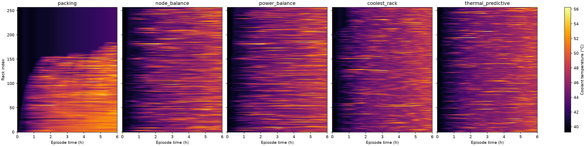
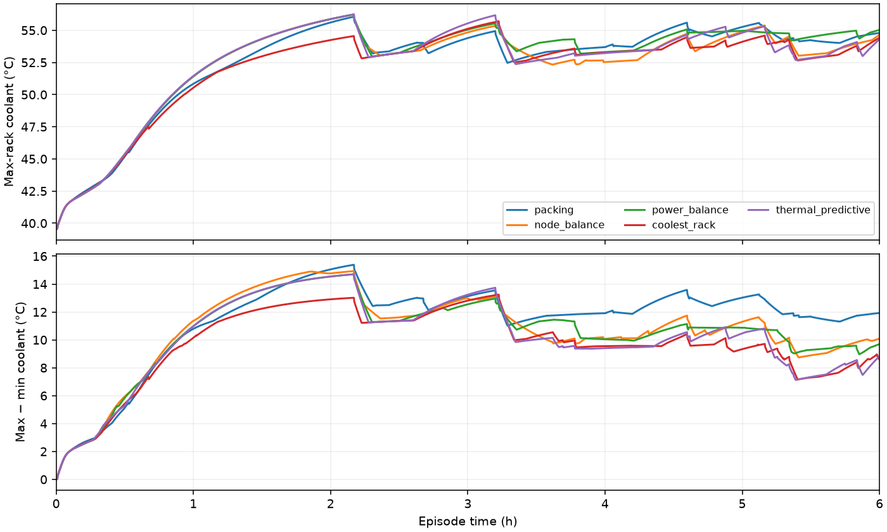

# E11 — Frozen G4 synthetic policy evaluation
**System:** summit  **Status:** complete
**Pre-registered:** 2026-10-30, commit `6ee93c4fb6e3fe019f2d57534d066f208b067c6d`; code anchor `ea3a26d`, before any E11 run. Review: [Opus prelaunch](../../../../../docs/checkpoints/C3-prelaunch-review-opus.md), reviewed `552e9b8`, review commit `66f7753`.

## Question
Does thermal_predictive demonstrate meaningful value beyond power_balance under the frozen protocol?

## Pre-registered decision rule
**Value beyond power** if `thermal_predictive` is ≥ 0.5 °C lower than `power_balance` in every seed. Otherwise: "no material value on the homogeneous twin". Also report the packing − thermal gap.

The primary metric is `maxrack_mean_c`, the time mean of per-tick maximum rack coolant temperature over **3600 < t_s <= 21600**, with 1800 right-endpoint samples. The G4 decision uses only this metric and the 0.5 °C rule in all three seeds. S1 and all other metrics are descriptive and never substitute for an unfavorable primary result. An invariant failure makes the policy conclusion INVALID pending review, rather than a negative G4 result.

Invariant 3 evidence scope (fixed before launch): (a) INHERITED — E10 packing seed 1, 2 h, same-config fresh-process rerun with byte-identical canonical decisions and identical interval values (experiments/summit/E10_c2_vertical_slice/provenance/rerun_1.json); this evidence was accepted at C2 and covers the 2 h E10 configuration only. (b) NEW, zero-cost analysis of matrix outputs (no extra run) — E11 seed-1 packing and power_balance must reproduce E10's canonical decision lines for t_s < 7200 byte-for-byte and interval values for t_s <= 7200 exactly (the E10 workload is the exact prefix of the E11 seed-1 workload; the decision path is unchanged since 0c32cf5). Six-hour E11 determinism was NOT independently re-measured; no E11 policy/seed configuration is repeated. A failure of (b) invalidates the G4 conclusion pending review.

## Configuration
[config.yaml](config.yaml) is byte-identical to the launch file `thermorl2/experiments/configs/g4_synthetic.yaml`; its bytes/hash and pinned sources are recorded in [provenance/preregistration.json](provenance/preregistration.json).

- Exactly 15 runs: packing, node_balance, power_balance, coolest_rack, thermal_predictive × seeds 1, 2, 3.
- Three workers, one FMU per OS process, Summit, 257 racks × 18 nodes, six GPUs/node, 10 s communication interval.
- Six-hour episodes, rho 0.6, nominal ambient: all T_Air and T_ext at 290 K.
- Each process uses a 7200 s capped warm-up at RAPS loss-inclusive idle, **not a settled state**. No warm-up/initialization rows enter metrics.
- Exactly 2160 episode FMU steps per run; backend episode clock ends at 21600 s.
- RAPS cooling disabled, output none, noui; FCFS with head-of-line blocking and no backfill; exact-node REPLAY assignments and frozen spanning rule.
- G1 frozen heuristic: a=27.9753857271229 °C, b=0.8052450824355937 °C/kW, tau=4050 s, prediction horizon=600 s. Exact source-derived values are recorded in the preregistration JSON and run manifests; no fit is performed here.
- Summit FMU SHA-256: `0a6ca3777ed38b75a94ea8d293a68748077db5963fa4b897fdea515615d19233`.

| Seed | Offered jobs | Workload SHA-256 (filename under ../_workloads/) |
|---|---:|---|
| 1 | 4589 | `c9bd815fe21806930edf225f6e3c443fcb4e8b49e905edb985190f77de967c27` |
| 2 | 4688 | `d2a64253d18fc92ee3c6bb42eec3189e5cc5ffd50743e3c71fc1dc4b88100b91` |
| 3 | 4660 | `7e06a12548f70d5b6fbd8d3edeacbccaafbe8486dfdea48caa5533696692aa0d` |

The files and sidecars were generated before policy outcomes in the locked Arch environment and are immutable. No regeneration is needed for launch. The original synthetic law, single-RNG draw order, MC representation and runtime quantization remain unchanged. Submit times are continuous, admitted at ceil(submit). Runtime quantization adds <1 s per job; RAPS completion bookkeeping adds another second of occupancy. Both apply identically to all policies.

## Method
Run from `thermoRL/thermorl-v2` on Arch Linux x86-64. Expected matrix wall time: **1.5–2.5 h**, an estimate with policy-dependent cost; record actual first-wave timings. No smoke or repeat simulations are authorized.

```bash
uv run python -m thermorl2.experiments.run_matrix --config thermorl2/experiments/configs/g4_synthetic.yaml --workers 3
uv run python -m thermorl2.experiments.evidence experiments/summit/E11_g4_synthetic
uv run python -m thermorl2.experiments.report experiments/summit/E11_g4_synthetic --evidence experiments/summit/E11_g4_synthetic/provenance/determinism_evidence.json
```

The evidence command performs only offline comparison of already produced outputs. It writes `prefix_vs_E10.json`, a separate per-seed `determinism_evidence.json` and its `.sha256` seal, with referenced-file hashes. Evidence is not part of the launch config. The report verifies the seal/references, obtains `t_hot_c` from pinned G1 and `grid` from the system registry, and compares each executed config against the launch config.

### Invariants (per seed, across all five policies)
1. Identical total IT kW on each power tick (absolute tolerance 1e-6 kW) and identical job start times.
2. Every placement uses exactly nodes_required distinct nodes, all free at the decision; replay completions and node reuse from required, SHA-recorded job_events.jsonl.
3. The approved evidence scope above. Per-seed status is `inherited_not_remeasured`; all have inherited_E10 evidence, and seed 1 additionally has NEW E11_prefix_vs_E10 evidence. No inherited item is labelled direct E11 verification. Every measured result must pass.
4. Sum of rack kW equals RAPS power_df Sum at every power tick, absolute tolerance 1e-6 kW.
5. Independently counted backend.step calls and power ticks equal 2160; the backend clock equals 21600 s, and the interval grid is complete.
6. Complete manifests and source/config/FMU/workload provenance; exact canonical/timing ledger joins and recorded hashes; job-events hash required. Canonical latency_us remains null and measured timings remain separate.

### Failure, retry and preservation rule
All jobs are preflighted for absent run directories and retry eligibility before launching any process. No raw run is overwritten. Every archive and stop records failure_kind and message. A non-scientific failure stops new launches and lets healthy in-flight runs finish. A scientific stop (FMU error, non-finite coolant, step/clock failure, invariant/validation failure or unexplained failure) stops the matrix; collateral partial runs are preserved. Scientific failures are refused by --retry-failed unless a separately recorded Bipin-reviewed override identifies the exact archive and hashed review. **No retry is authorized for this 15-run phase.** Any recovery requires review and remains capped at one retry. Coolant above 70 °C is reported, not a stop. Optimized Python is refused.

Run directories above 25 MB and all failed archives remain gitignored; `results/run_files.json` records every run file's relative path, bytes and SHA-256, plus console logs and matrix_events.jsonl. Smaller run directories are committed. Reviewers on other machines must obtain ignored raw files separately for full replay; summary artifacts alone do not replace those files.

## Metrics
Thermal and S1 window: **3600 < t_s <= 21600**. Per-tick argmax ties go to the lower rack index. p99 uses linear interpolation.

S1, descriptive only:
- rack_t_std_mean_c: time mean of across-rack population standard deviation (ddof=0) of t_c.
- top_decile_mean_c: time mean of the hottest ceil(0.1*257)=26 rack temperatures, selected independently at each tick.
- rack_kw_std_mean: time mean of across-rack population standard deviation of held rack kW.
- Max-rack attribution: per-tick argmax rack, share of evaluation ticks and resident job IDs reconstructed at the driving RAPS tick from job events.

Also report maxrack_p99_c, spread_mean_c, mean_rack_c, raw maximum, realized node utilization, hot rack-seconds above t_hot_c, temperature-only THI fraction below 0.10 (T_max=45 °C reference), pump/IT energy, jobs started/censored, wait mean/p95, counterfactual disagreement, policy self-reproduction and measured decision latency/timings.

`t_hot_c = 63.30492211035258 °C` comes from `experiments/summit/E01_g1_uniform/results/summary.json`, pinned via thermal_predictive.from and g1_sha256. G1 SHA-256: `b24aa61fbaab43f44f400c1af1923bc2895ded5a7c85c337c196c6dcc4af91c3`. It is not a safety threshold and is not refit. Hot rack-seconds may be about zero; report what is observed.

Interval rows mix RAPS-t inputs (kw/free/n_running/n_queued/it_kw_total) and FMU t+Delta endpoints (t_c/pump_kw). Whole-episode IT energy sums held rack kW×Delta; pump energy is a right-endpoint rectangle. Both exclude warm-up/initialization. Thermal metrics use the strict window. Waits are integer start minus continuous submit time. Jobs not started by the horizon are counted as censored and excluded from wait averages, including arrivals after 21599 s whose ceil admission is outside the episode. Waits are identical across policies by construction.

Disagreement rescoring applies BOTH power_balance and thermal_predictive to each identical six-decimal logged context, using globally distinct reconstructed free-node IDs. Self-reproduction against the live logged rack is reported separately because rounding ties can change a choice. Latency comes only from decision_latency.jsonl; missing means missing, never zero. RAPS, FMU, scheduler and total timing scopes remain separate in manifests. Committed kW is corrected for completions at the next power tick.

## Results
**Complete.** Frozen outcome: **no material value on the homogeneous twin**, value_beyond_power=false. All directly measured invariants pass; invariant 3 has the approved inherited scope and NEW seed1 prefix result, not full E11 remeasurement.

| Seed | packing | node_balance | power_balance | coolest_rack | thermal_predictive |
|---|---|---|---|---|---|
| 1 | 54.070216 | 53.883515 | 54.330429 | 53.534760 | 53.987934 |
| 2 | 54.177058 | 54.094552 | 54.137678 | 54.123498 | 54.284869 |
| 3 | 54.122798 | 53.559813 | 53.775784 | 53.780430 | 53.846649 |

| Seed | power_balance − thermal_predictive (°C) | packing − thermal_predictive (°C) | ≥0.5 °C beyond power? |
|---|---|---|---|
| 1 | 0.342495 | 0.082282 | False |
| 2 | -0.147190 | -0.107811 | False |
| 3 | -0.070865 | 0.276150 | False |

First-wave process wall times:

| Policy (seed1) | Fresh-process wall s |
|---|---|
| packing | 655.588 |
| node_balance | 1148.211 |
| power_balance | 602.637 |

Full matrix wall 4746.698 s. See [summary](results/summary.json), [metrics](results/metrics.csv), [S1 and attribution](results/max_rack_attribution.json), [diagnostics](results/decision_diagnostics.json), and [invariants](results/invariants.json).

**FACT/DERIVED — precision diagnostic:** rounded-context self-reproduction ranges across seeds are power_balance: 99.142%–99.232%; coolest_rack: 89.974%–90.601%; thermal_predictive: 94.785%–94.817%. These rates differ from fresh-process determinism: six-decimal logging can reverse close rankings, so the counterfactual diagnostic applies at logged precision and does not exactly reconstruct every live full-precision decision. No schema, precision or policy was changed.

## Plots




[packing vs thermal GIF](plots/anim_packing_vs_thermal_predictive_seed1.gif), [power_balance vs thermal GIF](plots/anim_power_balance_vs_thermal_predictive_seed1.gif).

## Observations (FACT)
Exactly 15 original runs, no retry. All runs have 2160 steps and a 21600 s episode clock. Total >70 °C samples: 0; raw max 56.931960 °C; negative episode pump samples 0. Full per-seed/metric numbers are preserved; no primary inference is drawn from S1.

## Interpretation (INFERENCE)
The frozen G4 outcome applies only to this policy, workload and Summit-FMU operating regime. Distributional metrics and max-rack attribution help interpret the result without replacing the primary metric. The plant mechanism behind C2 M3 is unresolved.

## Conclusion and decision
**no material value on the homogeneous twin** (`value_beyond_power=false`). This is the frozen every-seed half-degree rule at full precision. No tuning or additional run. Stop at C3.

## Limitations
- **M2:** max-rack temperature can be dominated by a rare long-running full-power large job saturating a rack under the frozen spanning rule. In E10 job 184 set the argmax throughout the window. Attribute, do not tune away, this effect.
- **M3:** E10 hottest racks had identical own-power trajectories and identical total power but different coolant trajectories under different placements of other load. The mechanism is unresolved; do not assert a hydraulic or thermal cause without evidence.
- S1 is descriptive only and cannot replace an unfavorable primary outcome.
- published view = FMU endpoint t+Δ of interval driven by P(t); decisions in (t, t+Δ) observe it (≤9 s hold-power forecast, E10 max 10 s per-rack change 0.31 °C, p99 0.057 °C); no future-decision information; identical for all policies.
- Warm-up is capped and evolving, not settled. The plant's preconditioning is identical across policies.
- G1 parameters are frozen heuristics, not validated predictors. Summit's uniform-load fit mixes facility and local effects.
- 45 °C is a reference, not a validated safety limit; t_hot is a model-fit reference.
- Only three seeds, one synthetic law and one homogeneous liquid-cooled POWER9 twin; no general scheduling advantage is implied outside this regime.
- Six-hour E11 determinism is not independently re-measured, including temperature-reading policies. Accepted E10 evidence and seed-1 prefix reproduction have the scopes stated above.
- Waits are identical by construction; hot rack-seconds may not discriminate policies.
- Summit uses loss-inclusive RAPS/FMU inputs, while frozen job_increment_kw understates committed between-tick additions by roughly 4%; it is not corrected here.
- Historical FMU state-restore jitter (1.43e-4 °C) is documented; episode processes are fresh and no restore experiment is added.
- FMUs are Linux/Windows-only. No PUE, plant-total energy, carbon, lifetime, heterogeneous-zone, RL or surrogate claims. The G3 what-if was dropped.
- Above-70 °C samples, raw maxima and affected racks are reported without changing the threshold or protocol.

## Provenance
[preregistration.json](provenance/preregistration.json) pins config bytes, G1/primary source hashes, workload/sidecar hashes and code anchor. Each run records git SHA/full porcelain, source hashes, real backend=fmu, verified FMU SHA, full resolved per-seed config, workload SHA, capped warm-up, step count/clock, ledger hashes and timing scopes. Existing unrelated user document changes are preserved and explained by git_status_porcelain.

## Demo relevance
This is the first frozen G4 policy evaluation. It can support only the measured placement-distribution effects and the prescribed thermal-versus-power comparison under this protocol. No preferred headline, policy ranking or RL direction is assumed.

Raw-run storage: every run exceeds 25 MB and is kept locally under `runs/`, gitignored. [Run sizes](results/run_storage.json) and [every raw file path, bytes and SHA-256](results/run_files.json), including console logs and matrix journal, are committed. [Manifest mirrors](provenance/run_manifests/) preserve the exact per-run manifest bytes for portable review. Obtain ignored raw ledgers separately for independent recomputation.
