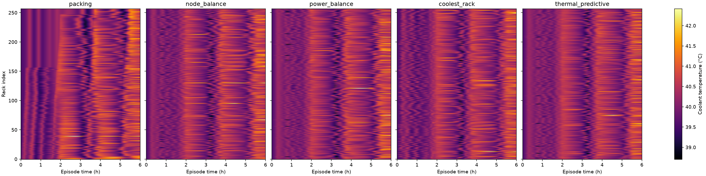
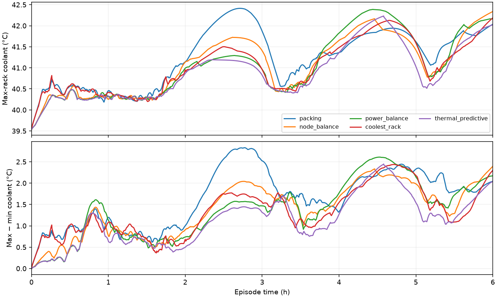

# E12 — G4 on an Alibaba GPU 2023-derived workload
**System:** summit  **Status:** complete; C4 results ready for Bipin/Opus review (2026-10-31).
**Pre-registered:** 2026-10-30, commit `ababba8220c2143c67a588a2fdc2d6e1062d9a4d`, after Task 13 `75363ee` and D5 `20ff68f`; before any E12 policy run.

## Question
Does the frozen thermal_predictive heuristic demonstrate material value beyond power_balance on the approved Alibaba-derived workload under the same G4 protocol?

## Pre-registered decision rule
**Value beyond power** if `thermal_predictive` is ≥ 0.5 °C lower than `power_balance` in every seed. Otherwise: "no material value on the homogeneous twin". Also report the packing − thermal gap.

Only **maxrack_mean_c**, the time mean of per-tick maximum rack coolant °C over **3600 < t_s <= 21600**, decides G4. Each seed must meet PB−TP ≥ 0.5 °C at full precision. No mean-across-seeds, alternate policy, secondary metric, threshold or workload tuning replaces this rule. Any measured invariant failure makes G4 INVALID pending review.

### D6: selected C′ determinism scope
The future experiment consists of **15 primary runs plus exactly one fresh-process six-hour thermal_predictive seed-1 rerun**, with full canonical decisions.jsonl byte identity and interval values exactly identical. The measured timing ledger is excluded from byte comparison; its join/hash validity still applies. Every process uses the same frozen inputs and a full capped 7200 s warm-up.

Direct `verified_E12` status may apply **only to thermal_predictive seed 1**, after the comparison passes. All other 14 primary policy/seed configurations remain `inherited_not_remeasured`, relying on E10's synthetic packing seed-1 two-hour evidence; this is weak cross-workload inheritance, not Alibaba reproducibility verification. No E11 synthetic-prefix comparison applies to E12. Any failed measured repeat or invariant invalidates G4; do not fall back to inherited-only A′ after failure.

[Machine-readable scope](provenance/determinism_scope.json) contains requirements and planned per-configuration statuses, with observed_result=null. The current E11 evidence generator/gate is not C′-compatible: **Task 14 must implement and test the E12-specific adapter before execution.** No policy simulation or rerun is authorized in this prelaunch assignment.

## Configuration
[config.yaml](config.yaml) is byte-identical to `thermorl2/experiments/configs/g4_alibaba.yaml`. It includes the three immutable workload/sidecar SHAs via workload.by_seed. System and predictor remain pinned through primary.yaml and G1.

- Summit, 257 racks × 18 nodes = 4626 nodes, six GPUs/node, power/communication interval 10 s.
- Five frozen policies × seeds 1, 2, 3: packing, node_balance, power_balance, coolest_rack, thermal_predictive. Three workers for the primary matrix; fresh OS process per run, one FMU per process.
- 6 h episode, 7200 s **capped, not settled** warm-up at RAPS loss-inclusive idle; 2160 episode steps; nominal 290 K ambient. RAPS cooling off, output none, noui, FCFS/head-of-line/no backfill, frozen spanning and committed-power semantics.
- Input rho=0.6 is the long-run cycle-average target derived from exact E[nodes×clippedR]. It does not promise a finite empty-start window at 0.6.
- G1 parameters unchanged: a=27.9753857271229, b=0.8052450824355937, tau=4050 s, H=600 s. Summit FMU SHA `0a6ca3777ed38b75a94ea8d293a68748077db5963fa4b897fdea515615d19233`.

| Seed | Jobs | Offset | Pod-count passes | Offered utilisation | SHA-256 |
|---|---:|---:|---:|---:|---|
| 1 | 21885 | 2935 | 3.528132 | 0.485766 | `7415a80132d0bcf993071b30bfdc586803c848e1ab582bc9730a71dfddab4c2c` |
| 2 | 19627 | 5195 | 3.164114 | 0.454619 | `28250b8c8834f281aa0cb56d35cb28d550fde05d01b8b36756116211f7fd8ead` |
| 3 | 19789 | 5033 | 3.190231 | 0.456625 | `1e09de8c6573a2474d38f7660da0126a4ce24919b3ba8a8ff1255fc5ad09b904` |

**Prelaunch review issue — utilisation.** The approved, untuned generator produces continuous offered-node utilisation **0.485766 / 0.454619 / 0.456625** over (3600,21600]. These are below the original 50–70% aspiration and the inline-fixture ±15% band; the real traces are not claimed to satisfy that band. The inline fixture passes its requested utilisation test. The real projection accounts for continuous submits, clipped durations, empty start and horizon overlap, but excludes RAPS admission/completion bookkeeping and queueing. No rho, scaling, duration, seed or horizon was adjusted. Review operating-regime acceptability before authorizing execution.

### D2 source and descriptive power statistics
Default is fixed by Bipin, not selected from policy outcomes or from the larger resource requests in multigpu50. `default` has 8152 raw rows and 6203 runnable non-Pending GPU>0 pods. `multigpu50` has 9061 raw resource rows and lacks pod_phase, creation_time and deletion_time; no phase/timing join or imputation is performed.

Node-weighted incremental kW above idle, through the frozen RAPS node-power model (network=0, loss-exclusive; not measured pod power):

| Population | Pods | Mapped nodes | Mean incremental kW/node | Share nodes using ≥2 GPUs |
|---|---:|---:|---:|---:|
| Default runnable (phase filter) | 6203 | 6247 | 0.319982 | 0.018889 |
| Default resource-only (GPU>0, no phase filter) | 7064 | 7108 | 0.316042 | 0.016742 |
| multigpu50 resource-only (GPU>0, phase unknown) | 7973 | 8529 | 0.476608 | 0.180560 |

The resource-only populations are labelled separately from the runnable set. [Full variant record](results/variant_choice.json), including unweighted pod means, was committed at `75363ee` before any policy run. Dataset verification passed all 26 checksums on Arch; raw CSVs remain outside git. No source data was modified.

### D3/D4 and assumptions A2–A4
**A2 / D3 — lifetime as runtime.** Interpret creation/deletion as seconds. Keep Running (4149), Failed (1869) and Succeeded (185) non-Pending GPU pods. Use deletion−creation as modeled runtime regardless of phase; the semantics of deletion for Running/Failed pods are not independently established. This is a lifecycle-to-execution assumption, not a claim of measured runtime. Clip to [300,21600], assert integer (no rounding), time_limit=ceil(1.5R). Source runtimes are integer seconds. Floors: **2033/6203 = 32.774464%**; caps: **266/6203 = 4.288248%**. RAPS adds its common one-second completion occupancy. All phase and clip statistics are retained in metadata.

**A3 / D4 — arrival-only compression and cycling.** Stable sort by (creation_time, original file row). Incoming gaps are [mean(diff creation), diff creation]; zero gaps and file-row ties remain. Choose one default_rng(seed) source offset, then cycle in that order. First submit waits the chosen pod's incoming gap. Wrap gap equals mean original IA. Compute exact E[nodes×clippedR] across all mapped pods; target IA=E[nodes×R]/(rho×4626); scale=mean original IA/target IA; divide each gap by scale, accumulate submits<horizon, admit at ceil(submit). Mean original IA **2080.258143 s**, target **1.008017 s**, compression **2063.712861×**. Durations are uncompressed. Nominal elapsed-time cycles are **3.454491**; actual normalized pod-count passes depend on rotation, as shown above. Seeds are correlated rotations, not independent resamples. Original burst ordering is retained, while absolute arrival/runtime time-scale relationships and the artificial wrap are assumptions. Job id i maps to ordered pod (offset+i)%6203; ordering/source hashes are preserved.

**A4 — weak power-density regime.** Almost all source jobs map to one node (max two); node-weighted mean GPU utilization is **0.878/6** and CPU **0.459/2** per node. CPU mapping assumes 20 cores/socket; GPU sharing and resources are mapped by the fixed spec formulas. These are static modeled loads, not utilization traces or measured power. Lower power density and no rack-filling source jobs may yield weak thermal contrast. This is legitimate external-validity scope, not a reason to increase power, choose another variant, or tune outcomes.

## Method
**Preparation executed on Arch (no FMU/RAPS policy simulation):**

```bash
# repository root / datasets/alibaba_gpu_2023
sha256sum -c checksums.txt
# cwd thermoRL/thermorl-v2
uv run pytest tests/unit/test_alibaba.py -q
uv run python -m thermorl2.experiments.run --config thermorl2/experiments/configs/g4_alibaba.yaml --prepare-variant
uv run python -m thermorl2.experiments.run --config thermorl2/experiments/configs/g4_alibaba.yaml --seed 1 --prepare-workload
uv run python -m thermorl2.experiments.run --config thermorl2/experiments/configs/g4_alibaba.yaml --seed 2 --prepare-workload
uv run python -m thermorl2.experiments.run --config thermorl2/experiments/configs/g4_alibaba.yaml --seed 3 --prepare-workload
```

**Prospective Task 14 commands — NOT authorized or executed here:**

```bash
# cwd thermoRL/thermorl-v2; only after prelaunch review and C′ adapter tests
uv run python -m thermorl2.experiments.run_matrix --config thermorl2/experiments/configs/g4_alibaba.yaml --workers 3
uv run python -m thermorl2.experiments.run --config thermorl2/experiments/configs/g4_alibaba.yaml --policy thermal_predictive --seed 1 --run-dir experiments/summit/E12_g4_alibaba/provenance/rerun_1/runs/thermal_predictive_seed1
# Generate a separate SHA-sealed E12 C′ evidence file using the Task14 adapter.
uv run python -m thermorl2.experiments.report experiments/summit/E12_g4_alibaba --evidence experiments/summit/E12_g4_alibaba/provenance/determinism_evidence.json
```

Do not invoke the current E11-only evidence command on Alibaba data. Future rerun files live under provenance/rerun_1/runs/ (automatically ignored) and need their own byte/SHA inventory plus a linked manifest; preserve the primary 15-run inventory. Never overwrite any primary or rerun directory. The extra run is excluded from primary policy metrics.

Expected execution cost is uncertain; no E12 benchmark has run. E11's 15-run analogue took 79.11 min at three workers, but E12 has about 4–5× as many jobs and a different power regime. No horizon, worker or primary-system switch is inferred from this estimate. Record first-wave timings when execution is authorized.

### Invariants (all primary runs, per seed)
1. Identical total IT kW per tick (absolute tolerance 1e-6 kW) and identical job start times across policies.
2. Exact nodes_required distinct free nodes per decision; complete lifecycle and node-reuse replay from required SHA-recorded job events.
3. C′ scope above: one direct full-six-hour repeat for TP seed1 only, others explicitly inherited. Canonical full-file bytes and interval values exact; timing ledger measured and excluded from byte comparison. Failed measured evidence => INVALID, not fallback.
4. Sum rack kW equals RAPS power_df Sum every power tick (1e-6 kW).
5. Independently counted backend.step calls=2160, complete 10 s grid, backend elapsed clock=21600, full 7200 s capped warm-up.
6. Complete manifests, source/environment/config/FMU/workload/sidecar SHA provenance; canonical/timing row joins and hashes, required job-events file/hash. Config equals frozen per-seed selection.

Frozen policies, spans, G1, primary.yaml, rho, seeds, horizon, warm-up and workload construction are unchanged. Stop for non-finite coolant, FMU error, invariant failure, frozen-item change, RAPS patch need or unexplained test failure. Above-70 °C samples are reported, not a stop. Scientific failures cannot be retried without a separately recorded Bipin-reviewed override. No retry is authorized by this prelaunch record.

## Metrics
Primary: maxrack_mean_c over **3600 < t_s <= 21600**; 1800 right endpoints. p99 uses linear interpolation.

S1, descriptive only in the same window: time mean of population rack-temperature std (ddof=0); mean hottest ceil(0.1×257)=26 rack temperatures selected per tick; time mean of population rack-kW std; per-tick argmax rack (lower-index tie), rack shares and resident job IDs at the driving RAPS tick from job events. No S1 metric replaces G4 or is generalized to all thermal/power metrics.

Also retain p99 maximum, mean rack, spread, raw max, hot rack-seconds at frozen G1 t_hot=63.30492211035258 °C, THI_T below 0.10 at T_max=45 °C reference, pump/IT kWh, realised utilization, jobs started/censored, waits, disagreement, self-reproduction, decision latency and separate RAPS/FMU/total scopes. Warm-up/initialization samples are excluded. kw/free/counts are RAPS-t inputs; t_c/pump are t+Delta endpoints. IT energy sums held kW×Delta; pump energy uses right endpoints.

Wait=integer start−continuous submit. Unstarted jobs are censored and counted separately, including admissions outside the horizon; no zero wait imputation. Disagreement reapplies both scorers to the same six-decimal logged context with distinct reconstructed free-node IDs. Self-reproduction is separate and imperfect for near ties; no exact full-precision decision reconstruction is claimed. Latency comes only from the joined timing ledger; missing means missing and canonical null is never zero.

## Results
**DERIVED — frozen G4 outcome: no material value on the homogeneous twin; value_beyond_power=false.** Primary metric is maxrack_mean_c over strict 3600<t_s<=21600. PB−TP must be ≥0.5°C in every seed at full precision.

| Policy | Seed 1 maxrack_mean_c | Seed 2 | Seed 3 |
| --- | --- | --- | --- |
| packing | 41.410869466295 | 41.345774966856 | 41.308922026266 |
| node_balance | 41.256918573934 | 40.969725531173 | 41.128894157054 |
| power_balance | 41.235138269180 | 40.981985391462 | 40.994658462517 |
| coolest_rack | 41.164820218149 | 41.239750477448 | 41.095216301964 |
| thermal_predictive | 41.057548338400 | 40.904720549522 | 40.885866893341 |

| Seed | PB minus TP (°C, full precision) | Packing minus TP (°C, full precision) |
| --- | --- | --- |
| 1 | 0.17758993078025043 | 0.35332112789507875 |
| 2 | 0.07726484193952388 | 0.441054417333838 |
| 3 | 0.10879156917675914 | 0.42305513292543395 |

[All metrics, all 15 runs](results/metrics.csv) · [full five-policy metric table](results/metrics.md) · [machine-readable decision](results/decision.json).

### Utilisation, waits and bursts

Nominal construction rho is **0.6**. Offered finite-window utilisation is a frozen input property; realised utilisation is derived from the RAPS ledger. These are not interchangeable. Values below are policy-identical within each seed; wait=integer start minus continuous submit, and unstarted jobs would be censored separately.

| Seed | Offered window utilisation | Realised ledger utilisation | Started | Censored | Wait mean s | Wait p95 s | Wait max s | Peak queued jobs (episode) | Queued fraction (evaluation ticks) |
| --- | --- | --- | --- | --- | --- | --- | --- | --- | --- |
| 1 | 0.48576559317193224 | 0.4856178844213863 | 21885 | 0 | 8.621865745 | 38.150916804 | 290.095277413 | 694 | 0.031666667 |
| 2 | 0.4546186900899609 | 0.4545704232117981 | 19627 | 0 | 6.000436318 | 0.996434839 | 235.551878482 | 564 | 0.023888889 |
| 3 | 0.4566251349855959 | 0.4565686698371524 | 19789 | 0 | 6.129541603 | 0.997273608 | 237.425800645 | 577 | 0.022777778 |


All offered jobs started. The pre-run continuous overload fractions remain approximately0.0297309/0.0229211/0.0233363. The table's queue fractions use 10 s RAPS input ticks in the evaluation window, so they need not equal continuous offered overload. Peak queues and maximum waits cover the episode; all other window quantities retain their explicit scope. Finite queues occurred during the accepted bursts. [Operational diagnostics](results/operational_diagnostics.json) include full-capacity fractions, IT-power ranges and waits>1s.

### S1, disagreement and latency (descriptive only)

These are arithmetic means across the three correlated rotations, not independent-replication estimates or alternative success criteria. Hottest decile means 26 racks per tick. Disagreement applies both scorers to the same six-decimal logged context; self-reproduction separately compares reconstructed and live choices. Latency uses only the measured joined timing ledger; canonical null is not zero. The last column averages each run's p95, not a pooled p95.

| Policy | T std mean °C | Hottest 26 mean °C | Rack kW std mean | PB/TP disagreement | Self reproduction | Latency mean µs | Latency p95 µs |
| --- | --- | --- | --- | --- | --- | --- | --- |
| packing | 0.341831156 | 40.866798333 | 1.610226442 | 0.823325836 | 1.000000000 | 467.309 | 923.608 |
| node_balance | 0.283261339 | 40.757659453 | 0.945876757 | 0.805687825 | 1.000000000 | 469.610 | 934.812 |
| power_balance | 0.270927089 | 40.716693993 | 0.794837828 | 0.918757164 | 0.998658047 | 486.515 | 951.194 |
| coolest_rack | 0.277970525 | 40.758891166 | 1.340267615 | 0.667398054 | 0.872954264 | 493.025 | 949.993 |
| thermal_predictive | 0.239485596 | 40.672633668 | 0.948892092 | 0.906591206 | 0.977281506 | 496.618 | 960.405 |


### E12's own endpoint attribution

| Policy | Seed | Most frequent endpoint max rack | Share of evaluation endpoints | Resident jobs min | Resident jobs max |
| --- | --- | --- | --- | --- | --- |
| packing | 1 | 39 | 0.381111111 | 2 | 18 |
| node_balance | 1 | 130 | 0.280000000 | 1 | 18 |
| power_balance | 1 | 121 | 0.291666667 | 1 | 18 |
| coolest_rack | 1 | 13 | 0.198333333 | 1 | 18 |
| thermal_predictive | 1 | 75 | 0.229444444 | 1 | 18 |
| packing | 2 | 0 | 0.415000000 | 0 | 18 |
| node_balance | 2 | 53 | 0.135555556 | 1 | 17 |
| power_balance | 2 | 15 | 0.266111111 | 0 | 18 |
| coolest_rack | 2 | 53 | 0.320000000 | 0 | 18 |
| thermal_predictive | 2 | 229 | 0.315000000 | 0 | 17 |
| packing | 3 | 3 | 0.255555556 | 0 | 18 |
| node_balance | 3 | 61 | 0.353333333 | 1 | 17 |
| power_balance | 3 | 162 | 0.215000000 | 0 | 18 |
| coolest_rack | 3 | 79 | 0.246666667 | 0 | 18 |
| thermal_predictive | 3 | 189 | 0.172222222 | 0 | 18 |


Resident counts refer to the endpoint-max rack at the driving RAPS tick, with completions before starts. Full identities, resident job IDs and per-tick shares are in [max-rack attribution](results/max_rack_attribution.json). These observations do not identify a physical mechanism and do not import E11's large-job explanation.

## Plots
All figures are **Alibaba-derived workload, Summit FMU, nominal, seed1**. Heatmaps share one temperature scale; animations share a scale within each comparison. They are descriptive and do not replace the frozen G4 rule.




[Alibaba-derived packing vs TP animation](plots/anim_packing_vs_thermal_predictive_seed1.gif) · [Alibaba-derived PB vs TP animation](plots/anim_power_balance_vs_thermal_predictive_seed1.gif).

## Observations (FACT)
All 15 selected primary runs and the one planned repeat completed; three interrupted primary attempts remain preserved. All per-seed invariants passed, and exact C′ passed for TP seed 1 only. Queueing was observed with zero final censoring. See Results and the dated completion addendum for measured values.

## Interpretation (INFERENCE)
The frozen outcome is "no material value on the homogeneous twin" in the accepted small-job, low-density, periodic-burst regime only. No result is generalized to high-power workloads, independent replications, safety or causal thermal mechanisms. S1 and disagreement remain descriptive.

## Conclusion and decision
**C4 reached: no material value on the homogeneous twin; value_beyond_power=false.** Exact C′ verifies TP seed 1 only. Stop for Bipin/Opus review before any Tasks 15–17 work.

## Limitations
- A2–A4 above: undocumented time units assumed seconds; Running/Failed lifetimes used as runtime, substantial clipping; arrival-only ≈2064× compression, artificial wrap and repeated correlated rotations; static resource-to-power mapping, low GPU/CPU density and max-two-node jobs; lower finite-window offered utilization than the nominal long-run target.
- **M2:** rare large/full-power jobs can dominate max-rack temperature in E11; that observed composition must not be assumed for this very different max-two-node source. E12 attribution will describe its own hottest racks without treating coexistence as causation.
- **M3:** E10/E11 exhibited non-local placement dependence at matched own/total power; the mechanism remains unresolved. No new characterization is a prerequisite or authorized.
- published view = FMU endpoint t+Δ of interval driven by P(t); decisions in (t, t+Δ) observe it (≤9 s hold-power forecast, E10 max 10 s per-rack change 0.31 °C, p99 0.057 °C); no future-decision information; identical for all policies.
- Capped warm-up is evolving, not settled; frozen G1 is a heuristic, not a validated predictor. Forty-five °C and G1 t_hot are references, not validated safety limits.
- C3 remains "no material value on the homogeneous twin" on its primary metric; packing≈TP there too. Distributional S1 statements are metric-specific and cannot be used as a substitute criterion.
- Prior reproducibility wording: "Fresh-process reproducibility was verified for E10 packing seed 1 (2 h) and, by exact prefix reproduction, for E11 seed-1 packing and power_balance over the first 2 h; no 6 h E11 configuration and no temperature-reading policy was repeated." E12's planned C′ repeat is not yet evidence.
- Six-decimal reconstruction cannot explain every live choice exactly; E11 self-reproduction was about 94.8% TP and 90.0–90.6% coolest_rack. Actual logged racks and rounded reconstructions are distinct.
- One homogeneous POWER9 twin, modelled coolant and power rather than production hardware measurements; only three correlated rotations. No PUE, plant-total energy, carbon, lifetime, heterogeneous-zone, surrogate or RL claims. G3 what-if remains dropped. No model, policy, fit, threshold or workload tuning.
- Summit between-tick committed job increments retain the documented roughly 4% loss understatement; actual FMU inputs use loss-inclusive RAPS rack power. No correction or G1 refit is made.
- Timing/canonical ledgers remain separate. Large raw data stays local/ignored with hashes and must be obtained separately for full-data review. Report/RAPS job volume is larger than E11; memory/runtime projections are uncertain.

## Provenance
[preregistration.json](provenance/preregistration.json) pins the byte-identical config, source module hashes, raw/derived inputs, sidecars, variant record and C′ scope before any outcome. Source CSVs and dataset version are hashed; no raw data was modified. Workload metadata records raw/filter phase mix, runtime clip counts/fractions, ordered source-row hash, offset/cycles, exact population expectation, representation, RNG draw rule, lineage rule, generator source SHA and numpy/pandas/pyarrow versions.

## Demo relevance
A preplanned external-validity test, not an attempt to rescue a positive thermal headline. The result remains scoped to the frozen rule, mapped Alibaba-derived input and Summit FMU. Tasks 15–17 remain outside this assignment.

## Prelaunch review addendum (2026-10-30)

Bipin approved E-A (proceed untuned) and E-B (keep the rotations) after review `5a0828b`; decisions are committed in plan addendum `f5d6dae`. Task14 now authorizes exactly 15 primary runs plus one isolated fresh-process TP seed1 repeat, after the engineering gates. This supersedes the historical prelaunch execution hold; all hashed protocol sections remain unchanged.

**Narrow regime:** small 1–2-node, low-density jobs with periodic bursts: approximately 23 minutes dense and 80 minutes near-silent per 1.74-hour cycle. A negative E12 does not confirm E11 for high-power regimes; a positive applies only here. No workload, policy, model, fit, threshold or timing parameter was changed.

| Seed | Arrivals per hour | Hourly mean offered utilisation | Window min/max | Exact time fraction >1 | Mean modelled kW/rack above idle | CPU cap clipping, pods |
|---|---|---|---|---:|---:|---:|
| 1 | 3278, 6195, 11, 6193, 21, 6187 | 0.2528, 0.3267, 0.4128, 0.5673, 0.4099, 0.7121 | 0.094250 / 1.150238 | 2.973093% | 2.872016 | 0.420379% |
| 2 | 1021, 6193, 12, 6195, 2178, 4028 | 0.0579, 0.3392, 0.2952, 0.5770, 0.3730, 0.6887 | 0.019023 / 1.123433 | 2.292106% | 2.676330 | 0.422887% |
| 3 | 1183, 6193, 12, 6195, 2086, 4120 | 0.0717, 0.3395, 0.3014, 0.5769, 0.3735, 0.6917 | 0.023346 / 1.124946 | 2.333633% | 2.686167 | 0.419425% |

[Full pre-run regime record](results/workload_regime.json). Offered demand is integrated exactly over positive-duration segments of continuous [submit,submit+R). Review values are rounded: [definition comparison](provenance/workload_regime_review_comparison.json) shows that 10-second sampling with ceil admission and +1 s occupancy gives the rounded review fractions/maxima. These are distinct descriptions; neither is realised RAPS occupancy. No input was modified to match the review.

The largest 20 creation gaps cover 76.900184% of the 149.325938-day source span. Only 3 eligible pods occur in the first 30 days; the first-percentile creation time is day 115.837838. The last-99%-of-pods tail compresses to 23.367041 minutes.

**Seed identity:** seed3 has 162 leading pods, then all 19627 seed2 job requests exactly, delayed 33.036572720579 s (maximum accumulated floating-point deviation 3.624e-13 s). Treat this as about two workload conditions. Seeds2/3 are not determinism or sensitivity evidence.

CPU cap clipping counts use uncapped mapped CPU>2; active-cap fractions including equality are also recorded. Source runnable default clips 26/6203 pods (0.419152%); resource-only multigpu50 clips 339/7973 (4.251850%). Power estimates use the frozen loss-exclusive node increment; actual loss-inclusive rack power comes from the future ledgers.

Nominal rho=0.6, offered finite-window utilisation (0.455–0.486 plus bursts), and realised ledger utilisation/waits/censoring must be reported separately. Queueing coverage, the lightweight parent seed check and C′ adapter are required before launch. D7 remains deferred; D8 is recorded for Task17 without editing the frozen spec.

## Execution interruption (2026-10-31)

The primary controller exited unexpectedly with code143 (SIGTERM), after approximately45minutes. Four primary runs completed and passed run-level validation; three started runs remain partial; eight primary configurations never started. No C′ rerun or evidence comparison was attempted. G4 is pending review, not a negative or positive policy result. No source was changed and no retry launched. [Interruption record](provenance/execution_interruption.json) and [complete/partial file inventory](provenance/interruption_inventory.json) preserve the state. The temporal association with45minutes is consistent with a session lifetime limit, but the cause is unresolved.

HEAD is deliberately kept at the launch SHA to preserve the exact Git precondition; interruption artifacts remain uncommitted pending recovery review. The committed preparation is pushed separately without advancing HEAD. Any retry budget, infrastructure/source change and resume plan need an explicit Bipin-reviewed decision.

## Task 14 completion and operational recovery (2026-10-31)

Earlier preparation/frozen sections retain historical future-tense wording; this dated result supersedes their execution-status statements without changing any preregistered text or hashes.

**FACT — C′ direct verification covers TP seed1 only.** Full 7200 s warm-up, 2160 steps and 21600 s elapsed were verified in both fresh processes. Config, workload, sidecar, FMU, source maps, Git SHA and environment matched exactly. Canonical decisions were byte-identical and complete interval values were equal with check_exact=True. Interval-file, job-event and thermal-publication bytes also matched (information only). Timing values were excluded from deterministic comparison, while row joins and hashes remained valid. The SHA-sealed evidence marks only TP seed 1 verified_E12; the other 14 are inherited_not_remeasured under "E10 synthetic packing seed1 2h only; weak cross-workload evidence". The entire matrix was not independently repeated. No A′ fallback or equality/tolerance change occurred.

All three seed gates passed: identical job starts, total IT power within 1e-6 kW, exact/free/distinct allocation and lifecycle replay, per-rack sum reconciliation, independent 2160-step/21600 s clock, complete provenance/ledger joins, and the accepted scoped C′ evidence. Maximum cross-policy IT-power difference is 1.8189894035458565e-12 kW in each seed. See [invariants](results/invariants.json), [comparison](provenance/full_rerun_comparison.json) and [sealed evidence](provenance/determinism_evidence.json).

**FACT — launches and attempts.** Original launch `18dfea14aa42bc21a191cc1f9a39fc421d8723bd`; recovery launch `e0e1522ac52b5780cb3088232051e26dbd492804`. Four completed seed-1 non-TP runs retain the original SHA and unmodified manifests. The other eleven selected primaries and the one repeat use the recovery SHA. The only production-source delta is `run_matrix.py` and `e12_evidence.py` orchestration/accounting; all numerical decision, workload, power, thermal, metric, input, FMU and RAPS paths are unchanged. Full source-map comparison, including the runner's additional RAPS entries, is recorded in [source identity verification](provenance/recovery_1/source_identity_verification.json).

Cumulative accounting is **19 attempts = 15 selected successful primaries + 3 preserved interrupted primary attempts + 1 successful planned repeat**. The primary journal has 18 starts/15 completions; the repeat has its own journal. Reusing 4 complete runs, restarting 3 interrupted configurations and executing 8 previously unstarted configurations produced the selected 15; no additional retry occurred. The interrupted TP seed 1, packing seed 2 and node_balance seed 2 directories were moved exactly once; their original console logs remain in place. [Historical inventory](provenance/interruption_inventory.json), [relocation inventory](provenance/recovery_relocation_inventory.json), [primary file inventory](results/run_files.json), [repeat inventory](provenance/rerun_1/run_files.json), and [portable manifests](provenance/manifests/) make preservation traceable. Completed raw run directories exceed 25 MB and remain local/ignored; interrupted archives remain ignored and inventoried regardless of size.

**UNRESOLVED — interruption origin.** The original interactive controller exited 143/SIGTERM around 45 minutes after first launch; exact origin is unknown. An interactive lifetime limit is an INFERENCE, not a proven cause. No FMU failure file, traceback or scientific stop was observed. Bipin's actual instruction was "dont stop, resume wherever it stopped". The 19-attempt accounting and restart scope are the agent's bounded operational interpretation recorded in C4-execution-recovery, not a separately supplied count or Opus approval of this source diff.

Durable user units `thermorl-e12-recovery-20261030T2050Z` and `thermorl-e12-postmatrix-20261030T2123Z` use RuntimeMaxSec=infinity, Restart=no and RemainAfterExit=yes. The second waited for successful primary exit, used the guarded repeat CLI, generated evidence, then ran the offline report. No source change or Git commit occurred from recovery launch through successful C′ evidence generation.

Original first-wave process walls (packing, node_balance, power_balance seed1): 1263.783793608, 1289.237131012, 1318.495860319 s. Recovery first-wave process walls (node_balance seed2, packing seed2, TP seed1, in completion order): 1245.809995674, 1323.944600355, 1688.275010045 s. These are individual process durations, not a sum or matrix duration. Recovery controller wall: **5033.356971426 s**, 11 completions. Original-start to final-primary-completion span: **9565.744325 s, including interruption/recovery downtime**. Primary systemd service ran 20:49:35–22:14:00 UTC; its startup/skip validation is outside the execute_jobs controller timer. The planned repeat took **1479.362240931 s** by guarded repeat subprocess-plus-validation timing and 1470.616880302 s by EpisodeRunner.

Selected-primary process peak RSS range: 1.630260–1.990356 GiB; interrupted-process RSS is unknown. Recovery controller own lifetime peak: 1.356224 GiB. Primary service cgroup high-water (controller plus concurrent workers): 6.925251 GiB. Repeat simulation own peak: 1.992161 GiB; its validating guard own peak: 1.304073 GiB. Offline report wall: **458.675731 s** after imports, with own lifetime peak **4.979103 GiB**, at most one five-policy seed loaded. The follow-up service cgroup high-water was 6414262272 bytes (5.973747 GiB), spanning the guarded repeat, comparison and report. Both services exited successfully with zero restarts and remain available for inspection. Service memory and process RSS have different scopes.

Raw storage: selected primaries **3044923184 bytes**, interrupted archives **326105782 bytes**, repeat **229356244 bytes**; all raw files are inventoried. Report artifacts/logs have a separate final inventory. All 15 primary episodes and the repeat recorded zero coolant samples above 70°C and no negative episode pump samples; threshold counts are descriptive, not a new stop rule.

| Policy | Seed | Selected attempt | Launch generation | Process wall s | EpisodeRunner total s | Peak RSS GiB |
| --- | --- | --- | --- | --- | --- | --- |
| packing | 1 | 1 | original | 1263.783793608 | 1260.936641046 | 1.990356 |
| node_balance | 1 | 1 | original | 1289.237131012 | 1286.458249398 | 1.949745 |
| power_balance | 1 | 1 | original | 1318.495860319 | 1315.874587496 | 1.787857 |
| coolest_rack | 1 | 1 | original | 1349.646937455 | 1346.572757732 | 1.830402 |
| thermal_predictive | 1 | 2 | recovery | 1688.275010045 | 1685.652488986 | 1.801899 |
| packing | 2 | 2 | recovery | 1323.944600355 | 1321.375245660 | 1.716881 |
| node_balance | 2 | 2 | recovery | 1245.809995674 | 1243.085100135 | 1.826305 |
| power_balance | 2 | 1 | recovery | 1359.289743542 | 1356.244498237 | 1.630260 |
| coolest_rack | 2 | 1 | recovery | 1250.291640019 | 1247.764879203 | 1.873169 |
| thermal_predictive | 2 | 1 | recovery | 1192.205407657 | 1189.483368714 | 1.900215 |
| packing | 3 | 1 | recovery | 1227.102041492 | 1224.441459747 | 1.912270 |
| node_balance | 3 | 1 | recovery | 1156.443074793 | 1153.695594268 | 1.913105 |
| power_balance | 3 | 1 | recovery | 1301.781750504 | 1298.907520066 | 1.913017 |
| coolest_rack | 3 | 1 | recovery | 1235.269872770 | 1232.621237463 | 1.912750 |
| thermal_predictive | 3 | 1 | recovery | 1184.902016036 | 1182.104559866 | 1.910912 |


### Executed commands and checks

```bash
# Original interactive primary launch (interrupted):
uv run python -m thermorl2.experiments.run_matrix --config thermorl2/experiments/configs/g4_alibaba.yaml --workers 3
# Recovery under the recorded durable systemd unit:
uv run python -m thermorl2.experiments.run_matrix --config thermorl2/experiments/configs/g4_alibaba.yaml --workers 3 --retry-failed
# Guarded follow-up, alone after successful primary completion:
uv run python -m thermorl2.experiments.e12_evidence rerun --config thermorl2/experiments/configs/g4_alibaba.yaml
uv run python -m thermorl2.experiments.e12_evidence generate --config thermorl2/experiments/configs/g4_alibaba.yaml
uv run python -m thermorl2.experiments.report experiments/summit/E12_g4_alibaba --evidence experiments/summit/E12_g4_alibaba/provenance/determinism_evidence.json
# Allowed tests, before source freeze:
uv run pytest tests/unit tests/integration -q
# Supplemental ledger-only diagnostics and final audit were run from /tmp;
# byte-identical scripts are archived under provenance/recovery_1/.
uv run python /tmp/e12_extra.py
uv run python /tmp/e12_final_audit.py
```

Exact service invocations/settings and sequencing are in `provenance/recovery_1/service_launch.json`, `post_matrix_service_launch.json`, `post_matrix_driver.py` and their journals. Preservation and freeze scripts are archived there too. Dataset command: `sha256sum -c checksums.txt` from datasets/alibaba_gpu_2023, 26/26 passed. Fresh non-FMU tier: **161 unit + 28 integration = 189 passed in 30.93 s**. No new full FMU pytest tier was run.

### Final scope and limitations

E12 tests only small (1–2-node), low-density, bursty Alibaba-derived jobs on the homogeneous Summit FMU. Nominal construction rho is 0.6; finite-window offered and realised utilisation are separate quantities above. Approximately 23 minutes dense plus 80 minutes near-silent occur per 1.74-hour cycle. Seed 3 is seed 2 shifted by 33.03657272057935 s after 162 leading pods: approximately two independent workload conditions, not three independent replications or a determinism test. A negative result does not confirm E11 for high-power regimes; a positive applies only to this tested regime.

A2: timestamps are assumed seconds; deletion minus creation is interpreted as runtime even for Running/Failed pods. Runtime clips remain 2033 floors and 266 caps among 6203 eligible pods. A3: arrival-only compression 2063.712860793521×, artificial cyclic wrap, empty start and correlated rotations change arrival/runtime relationships. A4: static CPU/GPU mapping assumes 20 cores/socket; about 99.3% of jobs use one node and the maximum is two. Actual loss-inclusive mean above-idle rack inputs are about 2.990621/2.787416/2.797622 kW; the pre-run mapping estimates 2.8720/2.6763/2.6862 kW were loss-exclusive offered statistics with a different definition.

M2: E11's large-job max-rack domination is not assumed here. E12 endpoint identities and resident jobs are derived separately in the E12 README and attribution record; coexistence does not establish causation. No individual E12 job fills a rack. M3: non-local placement dependence was observed in earlier work, but its physical mechanism remains unresolved.

S2, verbatim: published view = FMU endpoint t+Δ of interval driven by P(t); decisions in (t, t+Δ) observe it (≤9 s hold-power forecast, E10 max 10 s per-rack change 0.31 °C, p99 0.057 °C); no future-decision information; identical for all policies.

Warm-up is capped at 7200 s and is evolving, not settled. G1 remains a frozen heuristic, not a validated predictor. Between-tick committed job increments retain the documented roughly 4% loss understatement; actual FMU inputs are loss-inclusive RAPS rack powers. No correction or refit was made. Forty-five °C and G1 t_hot are references, not validated safety limits. Temperatures are modelled coolant, not hardware measurements. No PUE, plant-total energy, carbon, lifetime, heterogeneous-zone, causal-mechanism, RL or surrogate claim follows.

C3 is unchanged: **no material value on the homogeneous twin**, value_beyond_power=false; packing≈TP on the primary metric. E11 PB−TP gaps remain 0.3424946761284602, −0.14719002809689385, −0.07086450347454587 °C. S1 differences remain metric-specific. E11 reproducibility remains Option A: E10 packing seed1 2h fresh-process evidence plus exact E11 seed1 packing/PB two-hour prefix checks; no independent six-hour E11 run and no E11 temperature-reading policy repeat. D7 remains deferred and no E11 rerun was performed.
